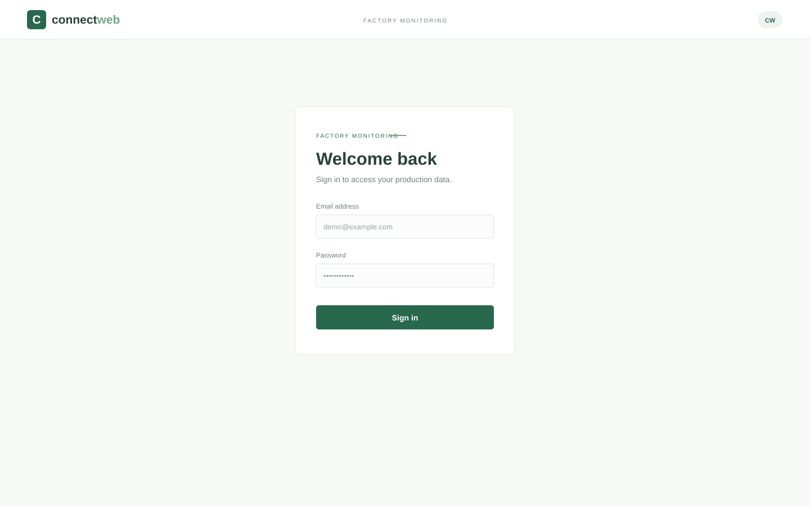
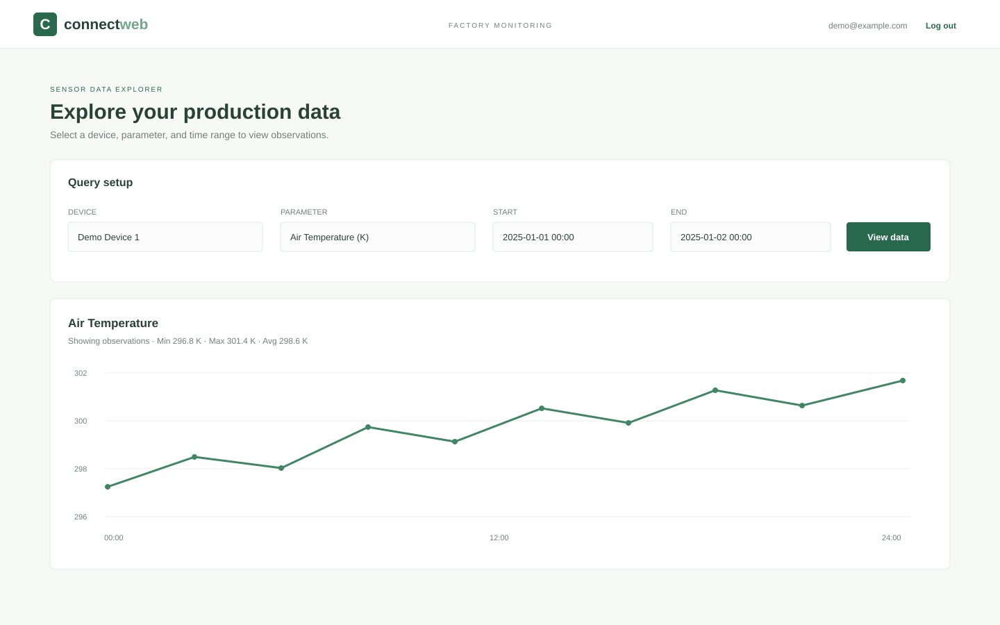
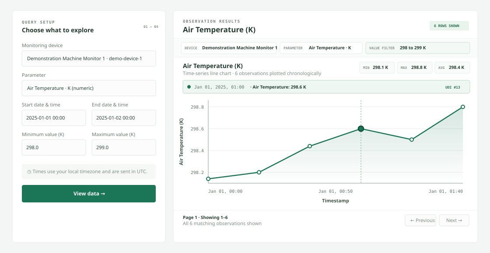
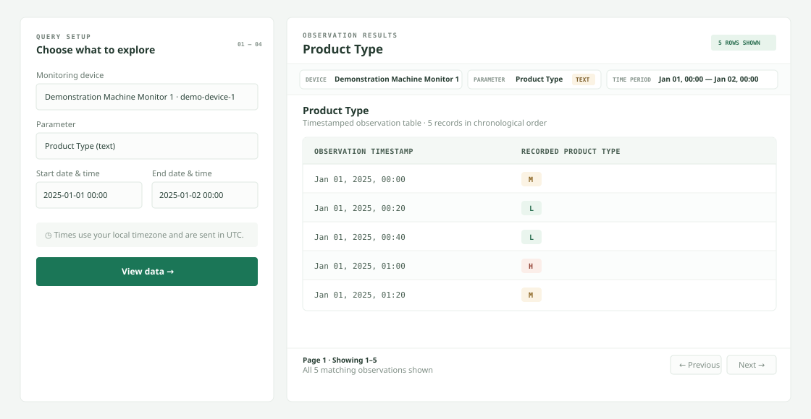

# Connect_Web

Connect_Web is a factory sensor data explorer built for the DataProphet software engineering assessment. It lets a user sign in, choose a monitoring device and sensor, filter timestamped readings, and view numeric data as charts or text data as a table. The backend provides authenticated device and observation APIs, and the supplied synthetic dataset gives the application a realistic week of demo readings.

**Jump to:** [What you can demonstrate](#what-you-can-demonstrate) · [Features](#features) · [Tech stack](#tech-stack) · [Quick start](#quick-start) · [How to use the application](#how-to-use-the-application) · [Screenshots](#screenshots) · [Dataset](#dataset) · [API](#api-overview) · [Authentication](#authentication) · [Tests](#tests-and-validation) · [Troubleshooting](#troubleshooting) · [Design decisions](#design-decisions-and-known-limitations)

## What you can demonstrate

Sign in, select a factory device and parameter, choose a time period, apply numeric minimum and maximum filters, and inspect the matching observations. Numeric parameters are shown as time-series charts; text parameters are shown in timestamp order in a table. The API also accepts timestamped readings and JSON batches.

## Features

- Email and password login with signed bearer tokens
- Device and parameter discovery
- Time-range and numeric value filtering with chronological results
- Numeric charts and timestamped text tables
- Individual observation writes and batch dataset import
- Synthetic seven-day factory sensor dataset
- Backend API and frontend automated tests

## Tech stack

| Component | Technology | Purpose |
| --- | --- | --- |
| Frontend | React, TypeScript, Vite | Authenticated data explorer and visualizations |
| Backend | Python, FastAPI, SQLAlchemy | REST API, validation, authentication, and persistence |
| Database | PostgreSQL 16 | Users, devices, parameters, and observations |
| Local environment | Docker Compose, Make | Build and run services with repeatable commands |
| Tests | Pytest, frontend test runner | Backend API and frontend behavior checks |

## Quick start

### Prerequisites

- Docker Engine or Docker Desktop with Compose v2
- GNU Make
- Git

Clone the repository, create a local environment file, and set private values for `POSTGRES_PASSWORD` and `JWT_SECRET_KEY` in `.env`:

```sh
git clone <repository-url> Connect_Web
cd Connect_Web
cp .env.example .env
# Edit .env and replace POSTGRES_PASSWORD and JWT_SECRET_KEY.
```

Start the services, import the demo readings, and create an account:

```sh
make up
make seed-devices
make create-demo-user DEMO_USER_EMAIL=demo@example.com DEMO_USER_PASSWORD='choose-a-local-password'
```

Open <http://localhost:5173> and sign in with the account you created. The API health check is at <http://localhost:8000/health>, and interactive API documentation is at <http://localhost:8000/docs>.

`make up` applies database migrations as the backend starts. The dataset import is safe to repeat: existing matching observations are skipped. Keep `.env` private and do not commit it.

## How to use the application

1. Sign in with the demo account.
2. Choose a monitoring device and one of its parameters.
3. Set the start and end date/time. The time controls use your local timezone; the API stores and returns timestamps in UTC.
4. For numeric parameters, optionally set inclusive minimum and maximum values.
5. Select **View data** to display the matching chart or text table.

## Screenshots

These screenshots show the login page, the authenticated explorer, and examples of numeric and text observations:

| Login | Authenticated explorer |
| --- | --- |
|  |  |

| Numeric observations | Text observations |
| --- | --- |
|  |  |

## Architecture and project structure

| Component | Technology | Responsibility |
| --- | --- | --- |
| Frontend | React + TypeScript + Vite | Sensor Data Explorer, charts, tables, and API client |
| Backend | FastAPI | Authentication, input validation, and device/observation endpoints |
| Database | PostgreSQL | Persistent users, devices, parameters, and observations |
| Compose | Docker Compose | Private service network, health checks, and persistent database volume |

```text
backend/
  app/api/       FastAPI routes, dependencies, and HTTP error handling
  app/core/      Configuration and security
  app/repository/ Database models and data access
  app/services/  Dataset and observation workflows
  app/scripts/   Dataset import and demo-user command line utilities
  data/          Timestamped demonstration dataset
  migrations/    Alembic schema migrations
  tests/         Isolated backend tests
frontend/
  src/           React application, API client, and visualizations
  tests/         Frontend automated tests
docs/screenshots/ Example numeric chart and text table
```

The root README covers the full-stack setup and demo workflow. For backend-only development, database configuration, migrations, CLI utilities, API details, and backend tests, see the [backend README](backend/README.md). Frontend-specific development notes are in [frontend/README.md](frontend/README.md).

## Dataset

`backend/data/factory_sensor_demo_7days.json` contains four synthetic monitoring devices, each with five numeric and two text parameters, and one week of timestamped observations. Timestamps are UTC. The data is for demonstration only and does not represent real factory measurements. Devices, parameters, and observations are persisted in separate tables.

The `make seed-devices` command validates and imports this JSON dataset transactionally. To validate it without writing to the database, run from `backend/`:

```sh
DEBUG=false APP_ENVIRONMENT=test uv run python -m app.scripts.device_dataset --validate-only
```

The importer also accepts another compatible JSON file with `--dataset /path/to/file.json`.

## API overview

| Method | Endpoint | Purpose |
| --- | --- | --- |
| `GET` | `/health` | Check that the API process responds |
| `POST` | `/api/auth/login` | Exchange email and password form data for a bearer token |
| `GET` | `/api/auth/me` | Return the authenticated account |
| `GET` | `/api/devices` | List monitoring devices |
| `GET` | `/api/devices/{device_uid}` | Get a device and its configured parameters |
| `GET` | `/api/devices/{device_uid}/observations` | Query observations by parameter, time, numeric bounds, and pagination |
| `POST` | `/api/devices/{device_uid}/observations` | Add one timestamped numeric or text observation |
| `POST` | `/api/devices/import` | Validate and import a nested JSON dataset batch |

`/health`, API documentation, and login are public. Other `/api/devices` routes and `/api/auth/me` require a valid bearer token. Observation time bounds and numeric value bounds are inclusive; date/time inputs must include a timezone.

To add one observation, provide a configured parameter, timezone-aware `observed_at`, and exactly one of `numeric_value` or `text_value`. Successful writes return `201` and the stored observation. The batch route accepts the same nested JSON structure as the supplied dataset and returns counts of created devices, parameters, and observations. The `make seed-devices` command is the simpler option for importing the bundled local dataset.

For direct login, the endpoint accepts URL-encoded form fields, with the email in `username`:

```sh
curl -sS -X POST http://localhost:8000/api/auth/login \
  -H 'Content-Type: application/x-www-form-urlencoded' \
  --data-urlencode 'username=demo@example.com' \
  --data-urlencode 'password=choose-a-local-password'
```

Use the returned `access_token` as `Authorization: Bearer <token>` on protected requests. See <http://localhost:8000/docs> for request and response schemas.

## Authentication

Passwords are stored as Argon2 hashes. Login issues a signed JWT containing the user ID and expiration. `JWT_SECRET_KEY` signs tokens, `JWT_ALGORITHM` defaults to HS256, and `JWT_ACCESS_TOKEN_EXPIRE_MINUTES` defaults to 30. Replace the template secret in `.env` with a private value (for example, `openssl rand -hex 32`).

The frontend keeps the token in memory and clears it on logout or when an API request returns 401. Refreshing the browser page requires signing in again. The application does not include account registration or token refresh. The demo-user command leaves an existing account unchanged and does not print the supplied password:

```sh
make create-demo-user DEMO_USER_EMAIL=demo@example.com DEMO_USER_PASSWORD='choose-a-local-password'
```

User and sensor data persist in the named PostgreSQL volume across `make down` and container restarts. `make clean-data` removes the volume and permanently deletes local database data.

## Tests and validation

Run the backend and frontend suites from the repository root:

```sh
make test-backend
make test-frontend
# or run both
make test
```

Backend tests use a fresh in-memory SQLite database and cover API workflows, authentication, validation, filters, and dataset import behavior without changing the Compose database. Frontend tests cover visualizations, authenticated API requests, and loading, empty, and error states. These tests do not replace checking the app against PostgreSQL through the Compose workflow.

For local non-Docker checks, install the backend dev dependencies with `cd backend && uv sync --group dev`, then use `uv run pytest`. In `frontend/`, use `npm test`, `npm run lint`, and `npm run build`.

## Useful commands

| Command | Action |
| --- | --- |
| `make up` | Build and start the stack |
| `make down` | Stop the stack while preserving the database volume |
| `make restart` | Restart running services |
| `make seed-devices` | Import the bundled timestamped dataset |
| `make create-demo-user ...` | Create a demo account |
| `make test` | Run backend and frontend tests |
| `make ps` | Show service status |
| `make logs` | Follow logs from all services |
| `make clean-data` | Remove the database volume and its data |

## Troubleshooting

- **Ports are already in use:** change `FRONTEND_PORT` or `BACKEND_PORT` in `.env`, then run `make up` again.
- **Compose reports missing or invalid variables:** compare `.env` with `.env.example` and check its syntax. `docker compose config --quiet` validates the configuration; avoid sharing resolved output because it may contain secrets.
- **Frontend cannot reach the backend:** check `make ps` and `make logs`, then open <http://localhost:8000/health>. The Compose Vite proxy uses the service name `backend`.
- **Backend does not become healthy:** inspect `docker compose logs backend db`, confirm database credentials, and allow startup time for PostgreSQL health checks and migrations.
- **Database authentication fails after changing credentials:** PostgreSQL applies initial credentials only when the data directory is first created. Existing data retains the original password. Use the original password or intentionally reset the volume with `make clean-data`.
- **Database data appears missing:** `make down` preserves the named volume. Check the active Compose project with `make ps` and list volumes with `docker volume ls`.

## Design decisions and known limitations

- Pydantic validates API input before persistence, and SQLAlchemy constraints provide a second validation layer in the database.
- Database access is isolated in repository modules; service code owns dataset and observation workflows.
- Backend tests use isolated SQLite fixtures. They are safe to run against local development data but do not test PostgreSQL-specific behavior.
- Observation results are paginated, with up to 100 readings per page; the frontend does not downsample or aggregate across pages.
- The backend health route is a liveness check and does not run a database query. Compose separately checks database readiness with `pg_isready`.
- The dataset is synthetic and intended to demonstrate the assessment workflow, not to model validated industrial operating limits.
